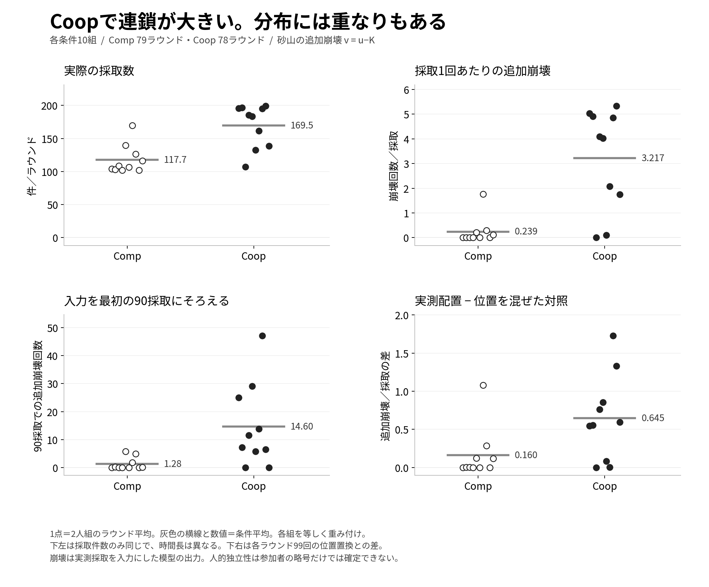

# CPRの採取記録で駆動する砂山：Coop／Comp比較

このディレクトリは、実験で記録された採取を固定Moore砂山へ入力し、協力条件（Coop）と競争条件（Comp）を比較した数値解析を収める。**最新の入口は [Coop／Comp比較の詳報](cpr_coop_comp/README.md)**。模型の定義と記号は [MODEL.md](MODEL.md)、依存環境・実行順・検証入口は [REPRODUCE.md](REPRODUCE.md) を参照する。

| 日付 | 意味 |
|---|---|
| 2026-11-21 | 同梱する主要解析・既存報告の日付 |
| 2026-11-22 | `primitive-lean` への追加日 |

## 最新の結果

今回のデータと模型では、Coopの方が採取数、追加の崩壊、連鎖の発生率・広がりが大きい。各ラウンドの指標を組内で平均し、その後、条件内の10組を等重みで平均した値を示す。採取あたりの指標も、ラウンドごとの比を先に計算している。

| 指標 | Comp | Coop |
|---|---:|---:|
| 観測窓内の採取件数／ラウンド | 117.7375 | 169.4583 |
| 追加崩壊回数 `Σv`／ラウンド | 42.7393 | 775.1042 |
| 採取1回あたりの追加崩壊 | 0.239118 | 3.217042 |
| 追加連鎖が起きた採取の割合 | 1.8062% | 12.9684% |
| 最大イベント面積／ラウンド（初回配分込み） | 10.2589セル | 77.2958セル |
| 最初の90採取による追加崩壊 | 1.27679 | 14.60000 |
| 実測配置から位置置換対照平均を引いた追加崩壊／採取 | 0.160201 | 0.644872 |

主比較の数値は [condition_comparison.csv](cpr_coop_comp/condition_comparison.csv)、固定90採取・配置対照の数値は [control_comparison.json](cpr_coop_comp/control_comparison.json) と [対照解析の説明](cpr_coop_comp/controls/README.md) に対応する。`v=u−K` は、各採取で保証される最初の源の配分を除いた模型内の崩壊回数である。実験のトークン再生回数とは異なる。

最終的な多重比較補正は `control_comparison.json` の `holm_seven`（上記7指標）を参照する。`condition_comparison.csv` の補正値は、主比較5指標だけを対象とした中間段階の値である。

図の点は各組のラウンド平均、灰色の横線は条件平均で、信頼区間を表す線ではない。図は [render_comparison.py](cpr_coop_comp/render_comparison.py) が数値データから生成する。

最初の90採取に入力件数をそろえても差は残る。一方、90件までの時間長はそろえていない。位置を99回入れ替えた対照でも大きな群差が残るため、総採取数や同じセルでの反復回数など、対照で保持した特徴の寄与も大きい。終端図の違いを、協力条件に固有の幾何模様の発見と解釈しない。各組の分布は重なっており、条件による完全な分離でもない。[詳報](cpr_coop_comp/README.md)

## 実験設計と推論の範囲

対象は同じ19×19盤面・初期トークン90個を用いた2人条件で、Compが10組ID・79有効ラウンド、Coopが10組ID・78有効ラウンド。各組IDは一方の条件に固定されており、同じ組の中で条件を切り替える設計ではない。157ラウンドを157個の独立標本として扱っていない。[設計監査](cpr_coop_comp/design/design_and_outcomes.json)

Coopの教示は合計得点、Compの教示は相手を上回る個人得点を目標とし、得点の閾値規則・表示にも違いがある。両条件とも会話・相談は禁止されている。比較対象は、この実験条件全体である。採取件数は、最初の盤面記録以上・最後の盤面記録未満の成功採取件数であり、閾値適用後の支払点数ではない。[Coop教示](cpr_coop_comp/design/instruction_coop.txt)・[Comp教示](cpr_coop_comp/design/instruction_comp.txt)

割付のランダム化は確認できていない。また、元の参加者欄の2文字表記には再登場があり、同一人物の再参加か表記の一致かは未確定である。20組IDと人的に独立な20組を同一視する仮定には留保がある。保存されたbootstrap区間・置換p値は、その独立性やラベル交換可能性を仮定する探索的な参考値である。詳報には表記の共有関係・機器中断・ラウンド範囲に関する感度比較を含む。[独立集計と感度の記録](cpr_coop_comp/audit/independent_results.json)

元のCPR指標にも、Coopは序盤の採取が少なく中盤の資源が多いという経過がある。例えば、最初60秒の採取はComp 90.9964、Coop 58.9042、60秒の資源数はComp 19.2375、Coop 62.1167。これは生ログからの記述集計で、砂山の崩壊とは別の量である。[設計・元指標の集計](cpr_coop_comp/design/condition_differences.csv)

## 同梱資料と再実行の境界

同梱する入力には、匿名化した採取イベントの時刻・座標、セル別採取数、盤面・砂山の配列、派生CSV、監査JSONがある。集計値だけの資料ではない。元の実験ZIP、参加者の実際のイニシャル、参加者欄を含む元の生ログは同梱しない。

| 作業 | 必要な入力・範囲 |
|---|---|
| 主比較・対照比較の再集計と図の再生成 | 同梱の匿名化入力・保存済み監査結果から実行する。詳しい順序は [REPRODUCE.md](REPRODUCE.md) を参照 |
| 追加対照の独立再集計 | [audit/check_controls.py](cpr_coop_comp/audit/check_controls.py) は保存CSVから平均・全置換p・補正値を確認する。保存監査記録では空間シミュレーションとbootstrap区間の再実行は範囲外 |
| 条件表・参加者表記を読み直す独立監査 | [audit/independent_compare.py](cpr_coop_comp/audit/independent_compare.py) は別保管の元2人実験ZIPを必要とする |
| 一次教示・条件表・元CPRログの再監査 | [design/audit_design_and_describe.py](cpr_coop_comp/design/audit_design_and_describe.py) は別保管の元2人実験ZIPを必要とする |
| 元ログから砂山入力までを再構築する処理 | 元ZIPと各スクリプトの参照成果が必要。同梱成果だけで再集計する経路とは区別し、[REPRODUCE.md](REPRODUCE.md) に入力境界を記す |

保存済みの独立監査JSONは既存解析の検証記録であり、原データを読み直した新しい監査実行の代わりとはしない。登録時の環境、依存の固定、検証コマンドと実際の実行結果も [REPRODUCE.md](REPRODUCE.md) にまとめる。

## 数学・Leanとの関係

この追加は、定義を明示した模型のPythonによる数値解析である。固定砂山の性質、観測データから得た数値、探索的統計を [MODEL.md](MODEL.md) で区別し、今回の採取駆動ASMについてLean証明を追加したとは扱わない。

関連する [PR #173「CPRの再生ポテンシャルと逐次更新の順序依存を形式化」](https://github.com/Sumuji-zkdwn/primitive-lean/pull/173) は、空セル周辺のトークン比に基づく再生確率と更新順序を扱う別モデルの形式化である。そのLean証明が、ここで用いる採取駆動Moore ASMやCoop／Compの統計的結論へ適用済みという意味ではない。
