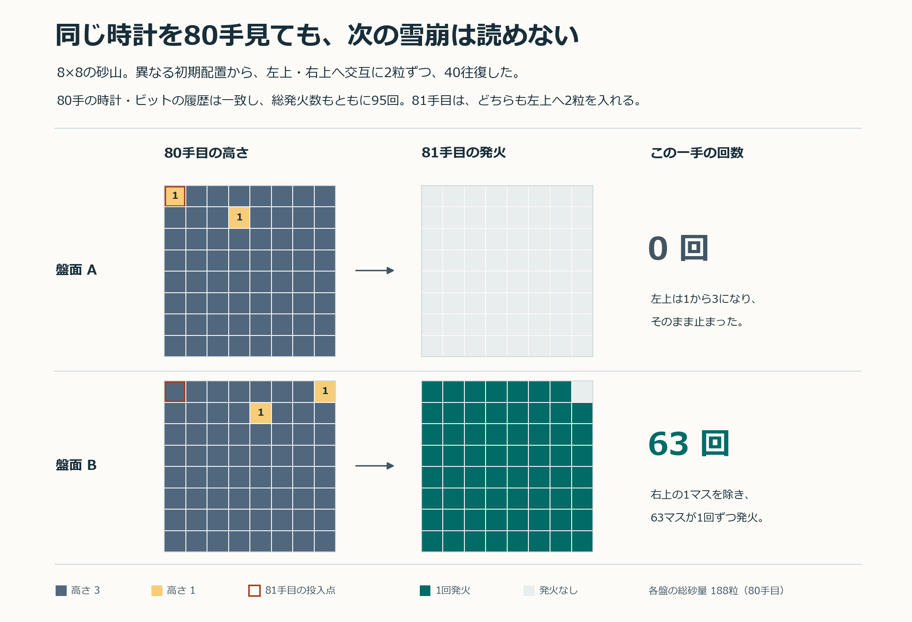

# 同じ時計を81手読んで、砂山の発火は95回と158回に分かれる

8×8の盤を二枚用意し、それぞれに158粒の砂を置く。左上と右上に交互に二粒ずつ、40往復落とす。四粒たまったマスは上下左右へ一粒ずつ送り、盤の外に出た粒は消える。この一回の動作を「発火」と数える。

80手を終えるまでに、両方の盤でちょうど95回発火する。81手目に、どちらの盤にも左上から二粒を落とす。盤Aでは左上が一粒から三粒になり、そこで止まる。盤Bでは雪崩が右上を除く63マスを一度ずつ通る。**最初から一粒落とすごとに時計と全ビットを記録しても、二枚の記録は最後まで一致する。**

| 入れる場所 | 盤Aの累積発火 | 盤Bの累積発火 |
|---|---:|---:|
| 80手まで（左40、右40） | 95 | 95 |
| 81手目も含む（最後は左） | 95 | 158 |
| 81手目も含む（最後は右） | 158 | 95 |

亜Laakso空間の構成に使った時計は、左に二粒入れれば一目盛り進み、右なら一目盛り戻る。表示目盛りは $q=2^{-1}\chi\bmod M$ であり、下で定義する整数の時計 $\chi$ と一対一に対応する。発火が何マスを通っても、時計はこの規則に正確に従う。では、投入の記録と時計を長く眺めれば、その間に起きた発火の総数まで推定できるだろうか。

## どんな大きさで差が残るか

一辺を $n=M-1$、$M=3^m$、$m\ge2$ とする。上辺の左角と右角を $L,R$ と書く。一手は、選んだ角に二粒を入れて安定化する操作。観測者には初期総粒数、全入力、各粒で安定化した後の時計と全ビットを知らせる。求める量 $U_N$ は $N$ 手までの全盤の発火回数である。

**定理。** $N=M^2$ とする。未来の入力を知る前に、同じ総粒数を持つ二つの再帰初期配置を固定できる。どんな共通入力列に対しても二配置の観測履歴は同じであり、左右の投入回数が一手だけ違う列では、二配置の $U_N$ の差の絶対値はちょうど $n^2-1$ になる。ここで再帰配置とは、有限砂山の繰り返しの力学で再訪できる安定配置をいう。

| 一辺 | 手数 $N$ | 最初の粒数（各盤） | 左が一手多いときの累積発火 A / B | 差 |
|---:|---:|---:|---:|---:|
| 8 | 81 | 158 | 95 / 158 | 63 |
| 26 | 729 | 1,938 | 1,449 / 2,124 | 675 |
| 80 | 6,561 | 18,894 | 17,360 / 23,759 | 6,399 |

### 左右を公平なコインで選んでも

各手の左右を独立に選ぶ。左右回数が一手だけ違う確率は $p_N=2\binom{N}{(N-1)/2}/2^N$ で、81手では約17.57%、729手では約5.90%である。この事象では、入力の順序がどうであれ観測から出せる予測は二枚に共通で、その二枚の絶対誤差の和は $n^2-1$ 以上になる。

したがって、どんな推定法でも、**あらかじめ固定した二枚の少なくとも片方で、コインに関する平均絶対誤差は $p_N(n^2-1)/2$ 以上になる**。$p_N\sim 2\sqrt{2/\pi}/M$ より、盤の一辺と同程度の単位 $M$ で誤差を割っても、最悪初期配置での平均誤差はゼロに近づかない。数式では

$$
\liminf_{m\to\infty}\ \frac{1}{M}
\inf_{\widehat U}\sup_{\eta\ {\rm recurrent}}
\mathbb E_{\rm inputs}\!\left[\,|\widehat U-U_{M^2}(\eta)|\,\right]
\ \ge\ \sqrt{\frac{2}{\pi}} .
$$

この期待値でランダムなのは投入の左右である。初期配置も全再帰配置から一様に抽選した場合の典型的な誤差の大きさは、別に求める必要がある。上の事象の確率そのものは $M$ とともに下がる。

**初期配置も抽選した場合の小さい実例。** 2×2だけは全192再帰配置と全512通りの九手の入力を調べられる。総粒数と各粒の観測をすべて使って最適な予測をしても、平均絶対誤差は $29005/49152\simeq0.5901$ 回、平均二乗誤差は $2828358109/4428103680\simeq0.6387$ 回²だった。各入力で観測の一致する配置をまとめ、その中の中央値・平均をそれぞれ予測値に使った結果である。左右の投入回数だけを残した10通りの計算でも、全98,304通りを逐次安定化した計算でも、同じ分数を得た。この一様初期の計算値は2×2での値である。

## 証明

**最後の一手を作る。** マスを上から $i$ 行、左から $j$ 列と数える。盤 $X$ は通常の高さを三粒とし、$L=(1,1)$ と $z=(2,n/2)$ の二マスだけを一粒にする。盤 $Y$ はその左右反転である。砂山の時計は $\chi(\eta)=\sum_{i,j}ij\,\eta_{ij}\pmod M$。$X$ の二つのくぼみの座標重みの和は $1+2(n/2)=M$ であり、左右反転で重み $ij$ は $-ij\bmod M$ に移る。従って両盤の時計は同じ。各ビットは高さの偶奇の加重和であり、三粒を一粒にした二マスはどのビットにも影響しない。発火は時計・ビットを保存し、一粒の投入による増分は投入点で決まる。[時計とビットの定義および保存則](formalization/SquareClock.lean)

どちらも再帰配置である。Dharの燃焼判定では、未燃の隣の数がそのマスの高さ以下になれば、そこを燃やせる。高さ三の部分は連結で盤の縁に接するため、縁からすべて燃やせる。最後にくぼみ二マスも燃える。[Dharによる燃焼判定の解説](https://arxiv.org/abs/cond-mat/9909009)

$X$ の左角に二粒を入れると、高さは三で止まる。右角に入れると、連結した高さ三の部分に順に発火が伝わる。内部のくぼみ $z$ には隣から少なくとも三粒届いて発火する。左角のくぼみには二粒だけ届く。どのマスも二度は発火できない。最初に二度目を迎えるマスを考えると、それまでに得た粒は、投入角なら初期の最大三粒・投入二粒・隣から二粒で高々七粒。他のマスでも初期の最大三粒と隣からの四粒で高々七粒である。二度の発火には八粒必要なので矛盾する。従って右からの発火はちょうど $a=n^2-1$ 回である。左右を反転すると $Y$ では答えが入れ替わる。

**最後の一手から出発点を決める。** 一般の $N=M^2$ に戻り、$k=(N-1)/2$ とする。左・右を各 $k$ 手入れる操作を $P$ と呼ぶ。再帰配置では投入操作が可換な置換であるため、逆像 $x=P^{-1}X,\ y=P^{-1}Y$ がそれぞれ一意に存在する。左右の投入量が同じなので $P$ は左右反転と可換で、$x,y$ も左右反転の関係にある。従って初期総粒数が一致する。$P$ による時計・ビットの増分は配置に依存せず、到着点での読みが等しいので、出発点でも等しい。以降どの共通入力を選んでも、観測の一致は毎粒保たれる。[投入の可換性](https://doi.org/10.1103/PhysRevLett.64.1613)・[逆像の一意性](https://doi.org/10.1103/PhysRevE.49.2684)

左・右を各 $k$ 手入れるまでの累積発火は $x,y$ で等しい。左右反転で入れ方も反転するが、同じ総投入なら、安定化後の配置と頂点ごとの累積発火数は投入順に依存しないからである。最後の左手または右手を追加すると、その一手で二枚の累積差が $+a$ または $-a$ となる。再び順序独立性を使えば、全 $N$ 手で左右回数が一手違うすべての列について同じ結果になる。これで定理と表の順序に関する主張が従う。

**逆像を実際に作る方法。** $\sigma(v)=4-\deg_{\rm inside}(v)$ を、マス $v$ から外に出る辺の数とする。これは有線ラプラシアン $\Delta$ に対する $\Delta\mathbf1$ であり、再帰配置に加えて安定化すると元に戻る。$X$ に $k\sigma-2k(e_L+e_R)$ を足して安定化すれば $x$ を得る。角で $\sigma=2$ なので足す量は全マスで非負。$y$ は $x$ を左右反転するだけで得られる。

### 時計がどの目盛りを指していても、一手の差を作れる

時計と全ビットの値を先に指定しても、同じ総粒数を持つ二盤で、その一手の発火数を左なら $0$ 対 $n^2-1$、右ならその逆にできる。ここでは投入直前の二盤を選ぶ。

$X,Y$ の両方から、同じ位置で同じ数だけ粒を引く。まず上辺の列 $2,3,9,\ldots,3^{m-1}$ を使う。周期はそれぞれ $3^m,3^{m-1},\ldots,3$ なので、それぞれのマスで一粒引くかを選べば、指定したビットだけを反転できる。次に第四行の列 $j$ で二粒引くと、ビットを保って $\chi$ を $-8j$ だけ動かせる。$8$ は $M$ と互いに素なので、変更なしと $1\le j<M$ の全選択で、すべての目盛りを作れる。

新しいくぼみを除いて、第二行以下の高さ三の領域は連結で、投入側の高い角から直接入れる。内部の $z$（またはその反転）と第四行のくぼみにはこの領域から少なくとも三粒ずつ届く。上辺の内側はどこも二粒以上あるので、直下と投入側の隣から一粒ずつ届けば、順に発火する。反対側の低い角だけが残る。再帰性は同じ下部領域を先に燃やし、二つのくぼみ、上辺の内部、残った角の順で燃焼判定を適用すれば分かる。

任意の長さの共通入力を先に指定した場合にも、この二盤を逆算できる。それまでの二盤の累積発火の差を $c$ とすると、最後の一手まで含めた差は左右によって $c+(n^2-1)$ または $c-(n^2-1)$ となり、少なくとも片方の絶対値は $n^2-1$ 以上である。この逆算では初期配置を指定入力に合わせて選ぶ。上のコインの定理では左右均衡の操作を使うことで、初期二枚を全入力より先に固定し、初期総粒数も一致させた。

## どこを測れば総数が分かるか

同じ実験でも、盤面を位置ごとに重み付けして量れるなら、必要な測定は最初と最後の二回で済む。盤外でゼロ、盤内で $\Delta w=1$ を満たす重み $w$ を用い、目盛りを $H(\eta)=\sum_v w(v)\eta(v)$ とする。一粒入れれば投入点の重みだけ増え、一回の発火でちょうど1減る。投入した各粒の位置を $v_1,\ldots,v_{2N}$ とすれば、

$$
U_N=H(\eta_0)+\sum_{i=1}^{2N}w(v_i)-H(\eta_N).
$$

元の時計が発火でいくつ進むかは、すべてのマスでゼロだった。目盛りの重みを選び直すと、この同じ盤で発火を一回単位で数えられる。

## 再現

このファイルのあるディレクトリで次を実行する。Pythonの標準ライブラリだけで8×8と26×26の初期配置を組み立て、再帰性、初期総粒数、各粒の観測、投入順を入れ替えた場合の最終配置と累積発火回数を検査する。二つ目のコマンドは、一手前の観測を指定する構成を両サイズの全36通り・全216通りで検査する。[長時間の例の検算](planar_followup/clock_avalanche_witness.py)・[全観測のテスト](planar_followup/test_clock_avalanche_witness.py)

~~~sh
python -B planar_followup/clock_avalanche_witness.py --m 2 3
python -B -m unittest discover -s planar_followup -p test_clock_avalanche_witness.py -v
~~~

80×80を再現するには同じコマンドで `--m 4` を指定する。8×8についてはLean 4.35.0でも、初期総粒数、燃焼判定、各粒の安定化後の表示目盛りと両ビットの一致、80手・81手の累積値を独立に計算した。定理 `ClockAvalancheExample.balanced_example` はカーネルで検査済みで、依存公理は `propext` のみ。全サイズの定理と期待誤差の下界は上の紙上証明による。[8×8のLean証明](formalization/ClockAvalancheExample.lean)
